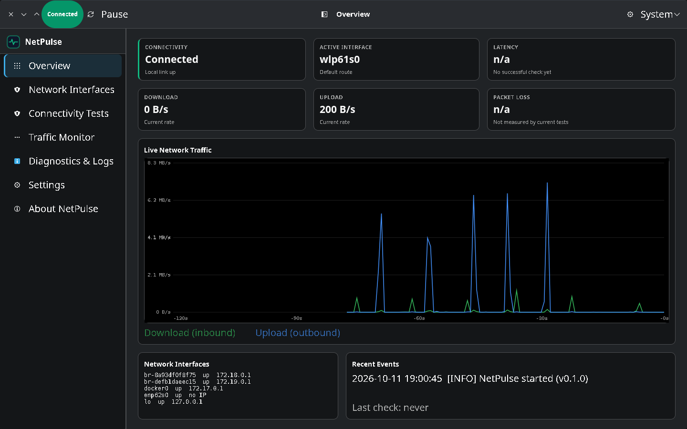
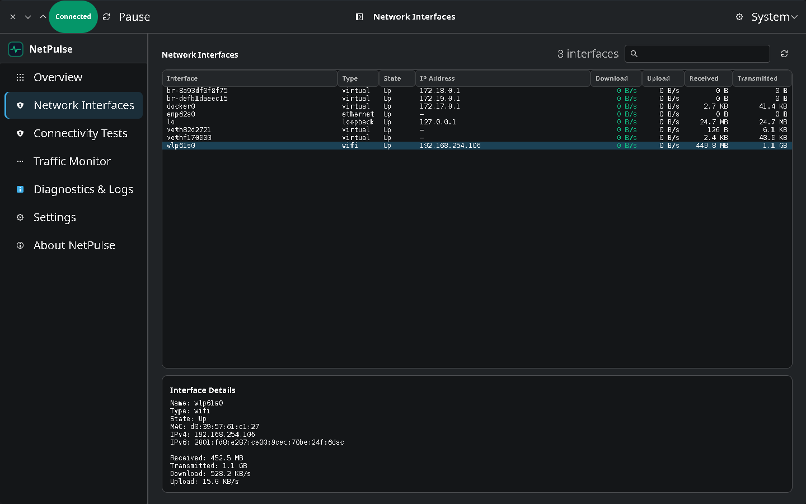
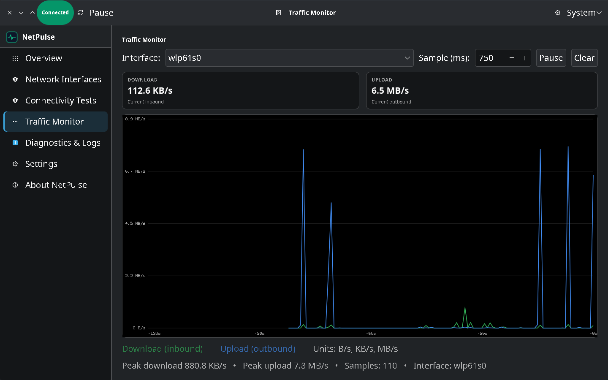

# NetPulse — Network Monitoring Dashboard

Native Linux desktop app (C17 + GTK 4) for real-time network monitoring,
connectivity diagnostics, interface inspection, and traffic visualization.
No Electron, no webviews, no simulated data.



## Features
- **Overview:** connectivity, active interface, live down/up rates, latency,
  honest packet-loss `n/a`, traffic chart, interface summary, recent events.
- **Interfaces:** sortable GTK `ColumnView` table (name, type, state, IPv4,
  down/up rate, rx/tx bytes) with live search, refresh, selection and a details
  panel. Real discovery via `getifaddrs()` + `/proc/net/dev` + `/sys/class/net`;
  IPv4/IPv6, counters, per-interface rates with reset/wraparound handling.
- **Connectivity:** DNS (system resolver), TCP (real socket), ICMP ping
  (`ping` child, no shell); async worker threads keep the UI responsive.
- **Traffic:** rolling chart (Cairo), interface + interval selectors,
  current/peak rates, pause/clear.
- **Logs:** search, severity / category / time-range filters, CSV export,
  confirmed clear.
- **Settings:** intervals, targets, theme, thresholds — persisted to
  `~/.config/netpulse/netpulse.conf`, validated.
- **Theming:** light/dark/system via `gtk-application-prefer-dark-theme`; the
  stylesheet is compiled into the binary with GResource, so an installed copy
  styles itself from any working directory.
- **Branding:** bundled app icon (`resources/icons/`) installed into the
  hicolor theme; regenerate with `scripts/mkicon.c`.

## Screenshots

| Network Interfaces | Traffic Monitor |
| --- | --- |
|  |  |

## Quick start
See [`docs/installation.md`](docs/installation.md):

```sh
sudo apt-get install -y build-essential gcc cmake ninja-build pkg-config \
  libgtk-4-dev libglib2.0-dev libcairo2-dev libadwaita-1-dev iputils-ping
cmake -S . -B build/debug -G Ninja -DCMAKE_BUILD_TYPE=Debug
cmake --build build/debug
./build/debug/netpulse
ctest --test-dir build/debug --output-on-failure
```

Without `libgtk-4-dev`, the core library + tests still build; the GUI target
is skipped with a warning until deps are installed.

## Layout
`include/netpulse/` headers · `src/core/` monitoring · `src/ui/` GTK pages ·
`src/services/` settings/export · `src/utils/` formatters/errors ·
`resources/` CSS + icons · `scripts/` maintenance tools · `tests/` g_test
suites · `docs/` guides.

See [`docs/architecture.md`](docs/architecture.md),
[`docs/ui-design.md`](docs/ui-design.md),
[`docs/user-guide.md`](docs/user-guide.md),
[`docs/testing.md`](docs/testing.md).

## Limitations (honest)
- ICMP ping needs the `ping` utility and ICMP permission; DNS/TCP need none.
- Packet loss is displayed as `n/a`: current tests don't measure it.
- Rates derive from kernel counters at the sampling interval (default 1 s).
- **Linux only.** Interface discovery and counters use `getifaddrs()`,
  `/proc/net/dev` and `/sys/class/net`; there are no Windows/macOS adapters, so
  this is not cross-platform yet.
- On KDE Plasma a dark global theme can override the in-app Light/Dark choice
  (see `docs/installation.md`).
- Some desktop themes (Breeze) make GTK log
  `GtkGizmo ... reported min width -2` for scrollbar handles. It comes from the
  theme's scrollbar styling in GTK 4.22, not from this code — a bare GTK
  application reproduces it, and `GTK_THEME=Adwaita` silences it.
- Version 0.1.0, MIT licensed.
